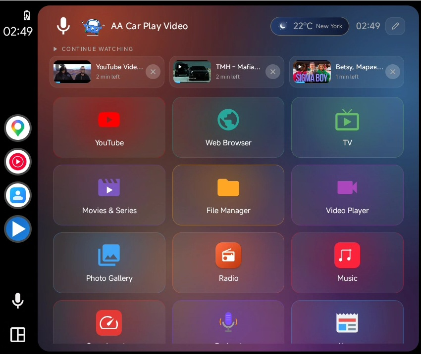
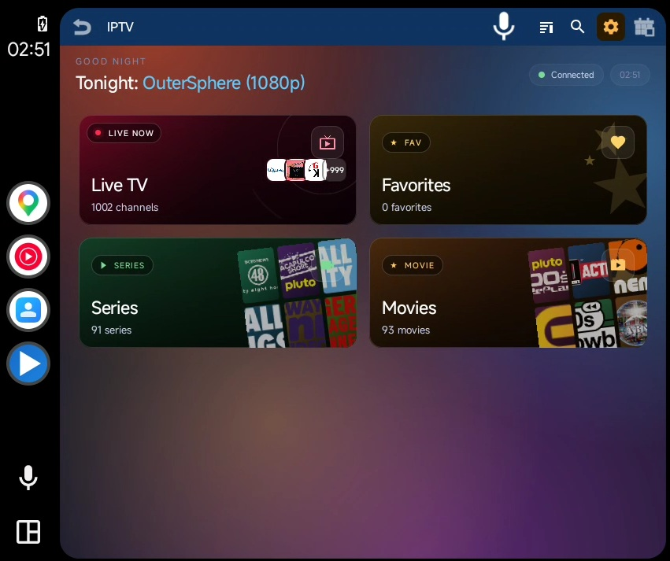
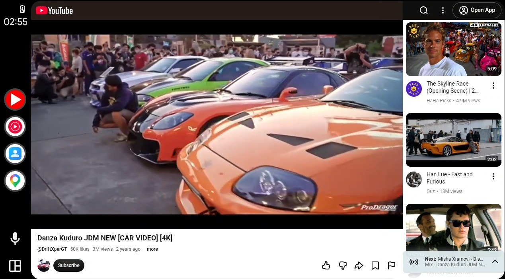

# AA Car Play Video

**Watch YouTube, IPTV, local videos and more on your car's Android Auto screen.**

No root, no developer mode, nothing to sideload. Installed from Google Play through an invite-only channel, so it shows up in Android Auto right away.

**Official website: [aacarplayvideo.com](https://aacarplayvideo.com)**

> [!IMPORTANT]
> AA Car Play Video is sold only through **https://aacarplayvideo.com**. If you bought it from any other website, seller or chat group, you did not receive the genuine app and we cannot support it.

This repository is the official documentation and install guide. AA Car Play Video is a commercial, closed-source app; the source code is not published here.

## At a glance

- Works on **Android 11 to Android 17**.
- **Wired and wireless** Android Auto, on **every car and head unit that supports Android Auto**.
- **YouTube up to 4K**, IPTV (M3U and Xtream Codes), Movies & Series, local video, music, radio, podcasts, browser, screen mirroring and more, all inside Android Auto.
- **One-time purchase**, no subscription. 24-hour free period after install.
- **10 languages**: English, Turkish, Spanish, German, Italian, Russian, Portuguese, Polish, French, Arabic.

## Screenshots

| Home screen | IPTV |
|---|---|
|  |  |

## How to install

AA Car Play Video is distributed through Google Play's closed testing channel. There is nothing to sideload and nothing to enable on the phone or in Android Auto. The only step is getting your Google account on the invite list.

1. Go to **https://aacarplayvideo.com** and request the free trial. Enter the email address your phone uses for Google Play.
2. Your address is added to the invite list, usually within minutes, at most a few hours. You receive an email with a Google Play link.
3. Open the link on your phone and install the app from Google Play like any other app. If the Play page says "item not found", the email you entered is not the one signed in to Play on that phone.
4. Connect the phone to the car. AA Car Play Video appears in the Android Auto app list on the first connection. No developer settings, no "unknown sources" toggle.
5. The first 24 hours are free. After that the app asks for a license key. Buy a license on the website, the key arrives by email, and you enter it in the app under **Settings > License key**.

Why it works this way: Android Auto only lists apps installed from Google Play. Installing from Play means no setup steps, no broken launchers after Android updates, and automatic updates from Play.

## What you get inside Android Auto

### Video

- **YouTube**: search, trending, channels, playlists, quality selection up to 4K, subtitles, playback speed, chapters, related videos, sleep timer, and ambient lighting around the video.
- **YouTube Kids** and **YouTube Music** as separate modules.
- **IPTV**: M3U and Xtream Codes playlists, live TV, movies and series, EPG program guide, favorites, watch history. Hardware decoding with a software fallback for older streams.
- **Movies & Series**: browse and play your own catalog sources with resume support.
- **Video Player**: play videos stored on the phone, with resume, playlist and subtitle support.
- **Screen Mirroring**: show the phone screen on the car display, with touch working both ways.

### Audio

- **Music** player with shuffle and repeat, **Radio** with hundreds of stations, **Podcasts** with charts and subscriptions.
- **5-band equalizer**, bass boost and virtualizer, with presets including a Car preset that compensates for road noise.
- **Steering wheel media buttons** work in every module.

### Everything else

- **Web Browser** with bookmarks and history, **File Manager**, **Photo Gallery** with slideshow, **News** reader with text-to-speech, **Weather**, **GPS Speedometer**.
- **Voice assistant** in 10 languages.
- Full support for **touch screens, rotary knobs and D-pad** controllers.
- **4 themes** including AMOLED black. **Driving mode** that limits distractions. **Background playback** with a mini player bar.

Video keeps playing while driving. We recommend using video features while parked or for passengers; the driver should keep their attention on the road.

## Requirements and compatibility

- Android phone running **Android 11 to Android 17**.
- A car or head unit with **Android Auto** support, wired or wireless. Every Android Auto vehicle works; there is no brand list because the app runs inside Android Auto itself, not on the car's own software.
- A **Google account** with access to Google Play, used both for the invite and for updates.
- **Internet connection** for YouTube, IPTV and other online modules. Local videos, music and photos on the phone play without internet.

Screen sizes from small 7-inch units to wide 12-inch and portrait displays are supported; the layout adapts to the head unit.

## FAQ

**Do I need to root my phone or turn on developer mode?**
No. The app installs from Google Play and appears in Android Auto on its own.

**The Google Play link says "item not found".**
The email on the invite list is not the one your phone uses for Google Play. Check Settings > Google on the phone and request the trial again with that address.

**Does it work with wireless Android Auto?**
Yes, wired and wireless connections both work, including cars with built-in wireless Android Auto.

**Does video play while driving?**
Yes. We recommend using video while parked or for passengers, and the driver should always keep their attention on the road. Follow the traffic laws in your country.

**What video quality can I get?**
YouTube plays up to 4K depending on the video and the head unit. IPTV and local files play at the stream's or file's native resolution.

**Does the app need a subscription?**
No. After the 24-hour free period you buy a license once on the website and enter the key under Settings > License key.

**Can I move the license to a new phone?**
Yes. A license is tied to one device at a time; you can transfer it yourself from the website's device change page.

**Which languages does it support?**
English, Turkish, Spanish, German, Italian, Russian, Portuguese, Polish, French and Arabic.

**Where do I get help?**
Through the support channel linked on https://aacarplayvideo.com. Updates arrive automatically through Google Play.

## Disclaimer

AA Car Play Video is a media player. It does not provide, host, sell or distribute any media content, TV channels, playlists, IPTV services, Xtream accounts, catalog sources or subtitles. Modules such as IPTV and Movies & Series only play sources that the user adds; those sources are operated by their respective providers, and users are responsible for the sources they add and for complying with the laws that apply to them.

For safety, video features are intended for use while parked or for passengers. The driver should never watch video while the vehicle is moving. Always follow the traffic laws in your country.

## Links

- Website and free trial: https://aacarplayvideo.com
- Guides and articles: https://aacarplayvideo.com/blog

AA Car Play Video is a trademark of AA CAR PLAY VIDEO LTD. YouTube, Android, Android Auto and Google Play are trademarks of Google LLC. This app is not affiliated with or endorsed by Google.
